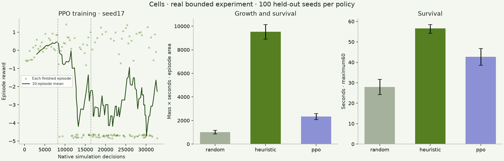

# PPO17 — first bounded learning experiment

Executed2026-10-16 on personal CT221, CPU only. Source revision
[`60f09e81c1008feecdbd0d4d4f589333393bcc1d`](https://github.com/spy-exe/cells/commit/60f09e81c1008feecdbd0d4d4f589333393bcc1d).
The native binary digest and exact dependencies are in model-manifest.json and
requirements-resolved.txt. These are measured results, not a trained production bot.

PPO trained32,768steps with0/3/7opponents, then restored its saved model/optimizer
and trained another512steps. Final33,280steps, changed model digest after resume.
Base run204.8s wall/135.3s CPU/293.9MiB peak; resume4.2s learning wall/6.3s whole-unit
CPU/282.3MiB peak. Units were capped at65%CPU/1100MiB/20min. No training ran in
CT220. Python3.13.5, PyTorch2.14.1+cpu, SB3 2.9.0, Gymnasium1.4.0,
PettingZoo1.27.0, NumPy2.5.4. No GPU, human data or paid inference API.

Evaluation:100held-out seeds100001..100100 **per policy**, same initial worlds,
seven utility opponents,60simulated seconds maximum. Compact arena3200,1200food,
12viruses; production uses6000/3600/24. Same physics coefficients, different
environment density. Evaluation took6min37s wall and4min13s CPU,236.8MiB peak.
All300episodes completed without an invalid-state error. Nine action replays
(three per policy) reproduced the exact final world hash before being saved.

| Policy | Mean peak mass | Mean mass×seconds | Mean survival | Eliminations/episode | Wins |
|---|---:|---:|---:|---:|---:|
| Random |47.76|1014.74|27.95s|0.00|0/100|
| Utility heuristic |273.81|9533.49|56.59s|0.14|10/100|
| PPO33,280 |58.65|2340.20|42.66s|0.00|0/100|

PPO accumulated2.31×random's mass-area but only24.55%of heuristic mass-area.
Paired bootstrap95%interval:21.51–27.64%,2000resamples/seed20261016. It also
survived less than the heuristic and scored no eliminations or wins. The model
**failed promotion**; keep programmed policies in production.

Compute-only latency excludes simulation/stdio. Mean of per-episode p95s:
random1.30µs, utility31.65µs, PPO942.87µs. Worst episode p95 for PPO3.84ms,
exceeding the2mslab gate. These are different implementations (native Go versus
Python/Torch), measured on a capped shared host, not a native ONNX benchmark or
end-to-end latency claim.

The frozen reference is the pre-goal-commitment policy from the source above.
Production0.3's bounded objective memory was developed separately and verified by
behavior tests; this comparison does not measure that newer heuristic's strength.
Do not mix simulator revisions when resuming or replaying this experiment.

Training points include every completed episode; line is a10episode mean. Dashed
boundaries mark curriculum changes. Comparison bars show actual means and bootstrap
95%intervals. Short PPO training did not converge to a strong tactical policy.

## Artifacts and reproduction

- [Raw summary](summary.json), [300episode CSV](episodes.csv),
  [training episodes](training.csv), [model manifest](model-manifest.json).
- Model ZIP, full command replays and resolved dependencies accompany
  [release0.3.0](https://github.com/spy-exe/cells/releases/tag/v0.3.0) as the bounded
  experiment archive. The trusted model is experimental and requires its recorded
  simulator/source; no arbitrary user-model upload or pickle execution is exposed.
- Commands: [laboratory README](../../../ai/README.md). Reproduce figures with
  `python -m ai.evaluation.plot --evaluation <recorded-evaluation-dir> --monitor <monitor.csv> --output <figure-dir>`.

Next experiments: keep these100seeds untouched as a published test set; reserve a
new validation range before tuning. Measure a64k/128k budget, longer episodes,
production-size density and profile-specific outcomes. Add observation ablations
and controlled teacher warm-start/self-play experiments only with separate manifests
and baselines. Reward changes need exploit regressions; more training alone is
not evidence of improvement. Native inference and promotion remain unimplemented.
