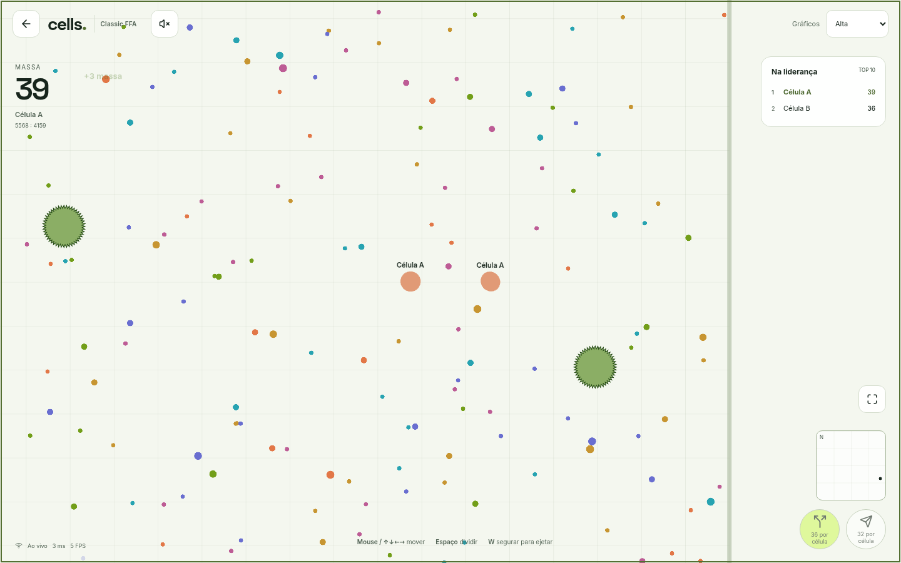
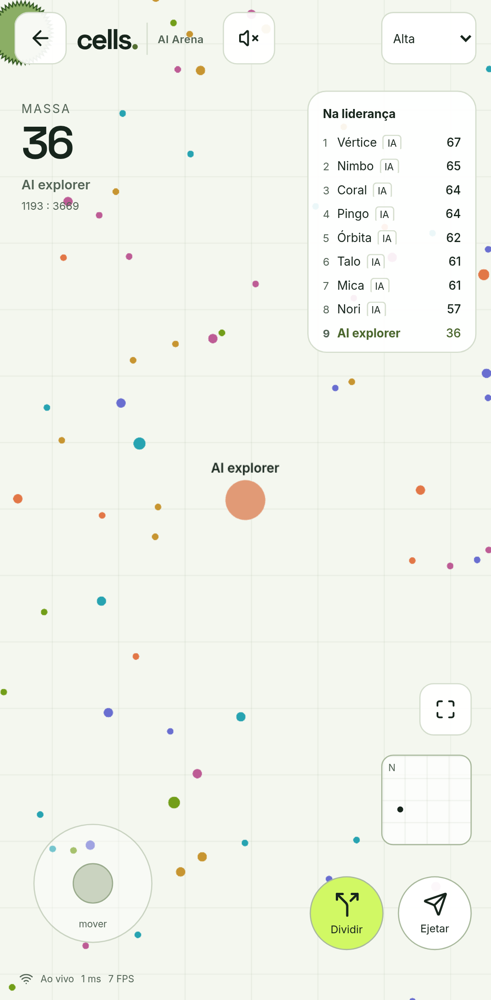
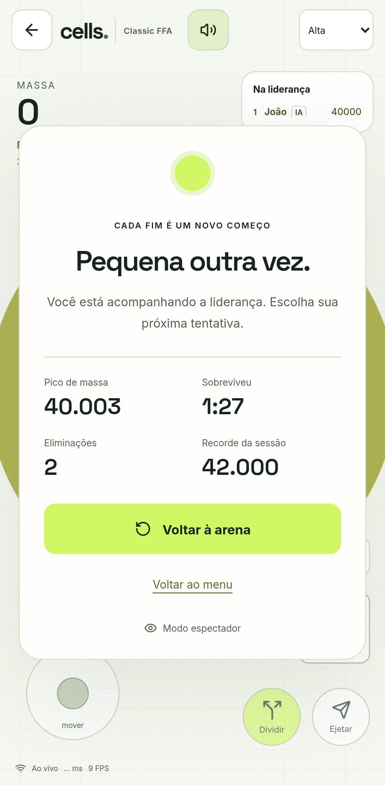

# Cells0.3.0 — feedback, round summaries and learning laboratory

Publication evidence: [GitHub release](https://github.com/spy-exe/cells/releases/tag/v0.3.0).
Public artifact version/revision: https://cells.malha.app/readyz. This report
describes the candidate's verified implementation; deployment is only confirmed
by the release's public smoke evidence and exact readiness revision.

## Implemented

- Vector cells stretch gently with movement and respond to growth. Deformation is
  bounded and preserves area; reduced-motion mode disables it. Collision physics
  remains authoritative and uses the actual circular body.
- Real positive mass deltas produce batched collection feedback. Split, decay and
  respawn do not manufacture collection points. Optional synthesized sounds follow
  received collection/split/ejection/death updates, activated by a player gesture.
- Server-owned round summaries show peak mass, survival, eliminations and session
  record; R restarts after the authoritative respawn cooldown. Statistics survive
  checkpoints. Existing active lives start duration measurement at migration,
  rather than inventing their past. Spectators have no played-round summary.
- Session-authenticated `/api/run` returns only its own identity's statistics,
  rate limited and uncached. Death freezes duration; respawn resets round values
  while retaining session records. No binary-protocol breaking change or database
  destructive migration.
- Tactical bots commit to nearly equivalent visible food objectives for up to1.5s,
  preventing constant direction changes. Richer alternatives, danger and expiry
  override that commitment. All policy memory fields survive deep-cloned saves.
- Gymnasium/PettingZoo adapters drive the production Go physics via bounded stdio
  commands. CPU PPO training, periodic fingerprinted checkpoints, tested resume,
  paired evaluation and verified action replays are real tools, not UI simulations.
  See [laboratory](../../ai/README.md) and ADR0004. Production remains heuristics
  unless a separately verified learned policy passes promotion requirements.
  The [first actual experiment](../ai/2026-10-16/README.md) completed33,280steps
  and300evaluation episodes. PPO mass-area was24.55%of the frozen utility baseline;
  it failed promotion. Nine action replays reproduced final world hashes. Training
  and its512step resume both completed within the dedicated laboratory bounds.

## Tests executed before publication

- RED regressions: missing training/replay interfaces, food-goal oscillation,
  missing round statistics, and missing deformation/collection logic. GREEN after
  implementation. Raw local logs live in `/tmp/cells-*-red.log` and their green
  counterparts; CI independently reruns the committed tests.
- `go test -race -coverprofile=... ./...` with isolated cells_test PostgreSQL:
  all eight packages containing tests passed. Statement coverage: engine91.3%,
  protocol93.0%, bot90.2%, training90.0%, store87.5%. Server/game orchestration
  coverage is lower; these are not branch-coverage or whole-project85% claims.
  Subsequent focused race tests and `go vet ./...` also passed.
  Final regression also covers a spawn consumed before its first completed tick:
  session record includes the initial36mass immediately, matching its round peak.
- TypeScript10 tests passed; lint/typecheck/build passed. Seven Python native
  environment/artifact tests passed, including Gym and PettingZoo contract checks,
  corrupt-model/replay rejection and conservative promotion gates. Four deployment
  boundary tests passed. `pip check` found no broken requirements.
- Playwright14/14 passed on isolated native QA, including real two-client play,
  reconnection, AI Arena and mobile emulation. After final CSS/keyboard edits,
  targeted feedback suite6/6 passed. The summary was checked at360×800,390×844,
  412×915,768×1024,1440×900, without horizontal overflow or a clipped overlay.
  Three tests per browser use explicit binary/API fixtures for visual/input states;
  they do not prove backend game outcomes. Actual multiplayer tests use the server.
- npm audit:0 reported vulnerabilities; configured secret-pattern scan clean;
  premium UI static audit strict:0 findings. These are bounded checks, not guarantees
  that no vulnerability or usability issue exists.

## Real browser captures

First two images show real QA gameplay; third uses clearly controlled statistics
for visual verification. Software-rendered headless browser FPS is low on this
shared host and is not evidence of60FPS on real phones. No physical Safari/iPhone
or high-refresh hardware run was performed.

## Operations and remaining work

Personal pve CT220 cells-prd-01,10.10.1.220,4vCPU/cap2,6GiB,40GiB; native Go,
PostgreSQL, cloudflared, systemd, nftables. CT221 cells-ai-lab-01 isolates learning:
1vCPU/cap.75,1.5GiB,8GiB, no public listener. Each experiment runs as cells-ai with
65%CPU/1100MiB/20min bounds and trusted root-owned code. Original project-only
DNS/TLS/tunnel and monitored metrics remain in use. Privileged deploy helper is
unchanged; CI artifacts undergo checksum/candidate/backup/readiness gates.

Backup/recovery and rollback procedures are in [infrastructure](../INFRASTRUCTURE.md)
and [prior measured release](0.2.1.md). The prior25/50/100-client load measurements
were not rerun as if they were new results. They are short local benchmarks, not
WAN/soak guarantees. Same-CT logical backups are not off-host disaster recovery.
No other applications or corporate environments were changed.

Priorities: evaluate more seeds/longer episodes and production-size arenas before
learned inference; improve tactical escape planning with controlled comparisons;
Teams/community; physical-device/WAN/soak validation; an authorized off-host backup
destination and authenticated Grafana provisioning. No unimplemented mode is exposed.

## Continuation prompt

Continue only Cells at /root/proj/cells. Read top of CONTINUITY.md, git status and
public /readyz before changing anything. Preserve spy-exe/cells history and native
production CT220. CT221 contains trusted CPU PPO experiments; inspect its actual
run manifests/results, never claim that training equals promotion. Freeze source
and simulator per experiment; do not sync a running laboratory. Production bots
use visible-information heuristics. Complete the next bounded improvement with
RED/GREEN, real browser checks, commit/push, successful CI and verified release.
Use source-specific model/evaluation artifacts; do not mix training revisions or
load untrusted model pickles. No other projects/corporate systems are in scope.
